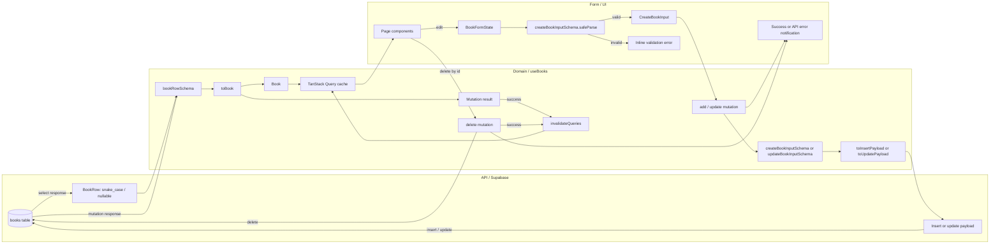

# API / Domain / Form データフロー

このドキュメントは、Supabase API、Domainモデル、フォームの間で本データがどう取得・変換・検証されるかを、現在の実装に沿ってまとめたものです。

## 全体図

## データの役割

| 層 | 型・スキーマ | 役割 |
| --- | --- | --- |
| Form | `BookFormState` | 入力中のUI状態。評価は文字列で保持し、空欄も表現する。 |
| Form / Domain境界 | `createBookInputSchema` / `updateBookInputSchema` | フォーム送信値を検証する。Mutationの更新入力型は`Partial<CreateBookInput>`。 |
| Domain | `Book` / `bookSchema` | 画面やアプリ内で使う本のモデル。任意値は`undefined`で表す。 |
| API境界 | `BookRow` / `bookRowSchema` | SupabaseのDB行を表し、nullable値とsnake_caseの列名を持つ。 |
| API書き込み | Insert / Update payload | Domain入力をDBの列名へ変換する。Insertの任意値は`null`にし、Updateは指定されたフィールドだけを含む。 |

## 読み込みフロー

1. `useBooks`の`useQuery`がSupabaseの`books`テーブルを取得する。
2. 取得結果を`bookRowSchema.array().safeParse()`で検証する。APIエラーまたはスキーマ違反はQueryのエラー状態になる。
3. 検証済みの各`BookRow`を`toBook`でDomainの`Book`へ変換する。
4. TanStack Queryのキャッシュをデータ源として一覧・詳細・編集ページが利用する。検索語とステータスフィルターはローカルUI状態である。

## 追加・更新フロー

1. `BookFormState`を`AddBookForm`が受け取り、入力中の値を管理する。
2. 送信時、評価文字列を数値へ変換し、`createBookInputSchema.safeParse()`で検証する。
3. 検証失敗はフォーム内のインラインエラーとして表示する。成功した`CreateBookInput`はページのコールバックから`useBooks`のMutationへ渡す。更新時は`Partial<CreateBookInput>`の入力と対象IDを渡す。
4. Mutation内で新規入力は`createBookInputSchema`、更新入力は`updateBookInputSchema`で再検証する。
5. `toInsertPayload`または`toUpdatePayload`がDB形式へ変換し、Supabaseへ書き込む。
6. 返却された単一行を`bookRowSchema.safeParse()`で検証してから`toBook`でDomain形式へ変換する。
7. 成功時は`invalidateQueries({ queryKey: ["books"] })`で一覧キャッシュを無効化し、再取得する。成功・失敗は画面上の通知で伝える。
8. 成功時、追加フォームは初期化する。更新フォームは初期化せず、ページ遷移または編集モード終了を行う。いずれもMutation成功時だけ実行する。

## 削除フロー

1. ページから対象IDを`deleteBook`へ渡す。
2. Delete MutationがSupabaseで削除し、成功時に`["books"]`のQueryを無効化する。
3. 成功時は通知を表示し、詳細ページから一覧へ遷移する。失敗時はエラー通知を表示し、その場に留まる。

## 主な実装箇所

- Query / Mutation、APIスキーマ検証: `src/hooks/useBooks.ts`
- Domain型とZodスキーマ: `src/types/book.ts`
- DB行・書き込みpayloadの変換: `src/utils/bookMapper.ts`
- フォーム状態と送信時検証: `src/components/AddBookForm.tsx`
- Supabaseクライアント: `src/lib/supabase.ts`
- QueryClientのProvider: `src/main.tsx`
