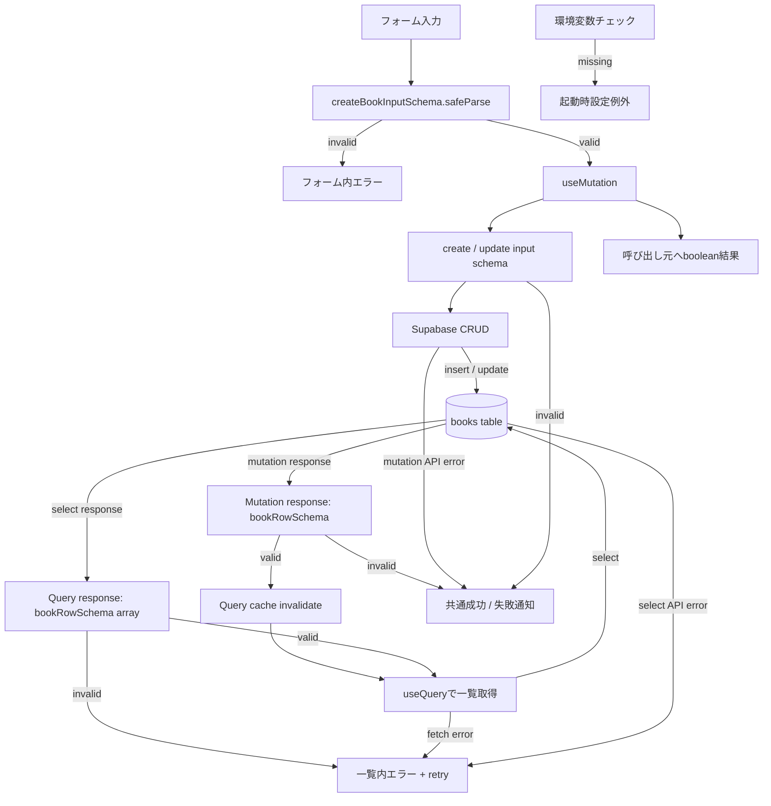

# エラーハンドリング設計

このドキュメントでは、入力検証、Supabase API、TanStack Query、画面表示にまたがるエラーの分類と伝達方法を定義します。現在の実装を基準にし、既存の責務境界を保つ方針です。

## 基本方針

- エラーは利用者が対応できる場所に表示する。入力エラーはフォーム内、一覧取得エラーは一覧内、CRUD操作エラーは共通通知に出す。
- Promiseの失敗を成功として扱わない。Mutation呼び出し元は成功時`true`、失敗時`false`を受け取り、遷移やフォーム初期化は成功時だけ行う。
- Mutationエラーは開発者向けにコンソールへ記録する。QueryエラーはQuery stateとして画面へ渡す。利用者向け文言は操作に沿った説明を基本にし、技術詳細を出す場合は公開情報であることを確認する。
- Zod検証は入力境界とAPIレスポンス境界の両方で行い、検証失敗データをDomainモデルへ流さない。

## エラー分類と表示

| 発生箇所 | 検出方法 | 画面への伝達 | 回復方法 |
| --- | --- | --- | --- |
| フォーム入力 | `AddBookForm`の`createBookInputSchema.safeParse()` | フォーム直下のインラインエラー。項目の編集で現在のエラーを消す。 | 入力値を修正して再送信する。 |
| Mutation入力の再検証 | `useBooks`内のcreate/updateスキーマ検証 | Mutationの`onError`から共通エラー通知。フォーム側検証を迂回した場合への防御。 | 入力を修正する。 |
| 一覧取得API / 一覧レスポンス形式 | `useQuery`がSupabaseエラーまたは`bookRowSchema`エラーをthrow | 一覧には一般的な案内のみを表示し、Supabaseや通信エラーの内部詳細は表示しない。再試行中は進行表示を出し、ボタンを無効化する。 | 「再試行」から`refetch`する。 |
| 追加・更新API / 単一行レスポンス形式 | MutationがSupabaseエラーまたは`bookRowSchema`エラーをthrow | 共通エラー通知。呼び出し元には`false`を返す。 | 内容や接続を確認して再操作する。失敗時はフォーム値を保持し、画面遷移しない。 |
| 削除API | Delete MutationがSupabaseエラーをthrow | 共通エラー通知。呼び出し元には`false`を返す。 | 詳細画面に留まり、必要なら再操作する。 |
| Supabase環境設定 | `src/lib/supabase.ts`の必須環境変数チェック | モジュール初期化時に例外。通常の画面通知より前の起動設定エラー。 | `.env`の`VITE_SUPABASE_URL`と`VITE_SUPABASE_ANON_KEY`を設定して再起動する。 |

## データフロー

## CRUD結果の契約

`addBook`、`updateBook`、`deleteBook`はPromise<boolean>相当の結果を呼び出し元へ返します。

- `true`: Mutationが成功し、成功後のキャッシュ無効化処理を終えた。
- `false`: 入力検証、Supabase処理、レスポンス検証などMutationが失敗した。
- ページは成功時だけ遷移または編集モードを終了する。
- `AddBookForm`は成功時だけフォームを初期化する。
- エラー通知はMutationの`onError`で設定する。呼び出し元は同じエラーを重複表示しない。

## 通知の挙動

- 成功とMutationエラーは`BookNotification`として`useBooks`から公開する。
- `App`が画面上部中央（上端から24px）に通知を表示し、×ボタンまたは表示から5秒後に閉じる。
- 成功通知は淡い茶色、エラー通知は淡い赤系の配色を使用する。
- フォーム検証エラーは送信内容に直接結び付くため、共通通知ではなくフォーム内に表示する。
- Queryの一覧取得エラーは一覧領域内に表示し、通知とは別に再試行導線を設ける。

## エラーメッセージとログ

`formatErrorMessage`はZodErrorの場合に限り、基本メッセージに問題のパスとZodの説明を追加します。その他のエラーでは基本メッセージのみを返します。Mutationエラーは`console.error`にも記録します。

フォームのZodErrorはフォーム自身でissueのメッセージを表示します。Supabase APIエラーの内部コードや詳細は利用者向け通知に含めません。Query取得エラー画面にも`Error.message`を表示せず、一般的なエラー案内と再試行導線だけを提示します。開発者向けの詳細調査は開発環境のログやQuery stateを利用します。

## 再試行方針

- 一覧QueryはTanStack Queryの既定リトライ設定を利用する。
- 自動リトライ後も失敗状態の場合、利用者が「再試行」ボタンで明示的に再取得できる。
- `isFetching`中は進行中メッセージを表示して再試行ボタンを無効化する。
- Mutationは自動再送を行わない。作成・削除など非冪等操作の重複実行を避け、利用者の明示操作で再試行する。

## 主な実装箇所

- Query / Mutationのエラー化、通知、boolean結果: `src/hooks/useBooks.ts`
- フォーム入力検証とインラインエラー: `src/components/AddBookForm.tsx`
- 一覧取得エラーと再試行UI、共通通知表示: `src/App.tsx`
- Zodエラーの利用者向け文字列化: `src/utils/errorHandler.ts`
- Supabase環境変数の起動時検証: `src/lib/supabase.ts`
